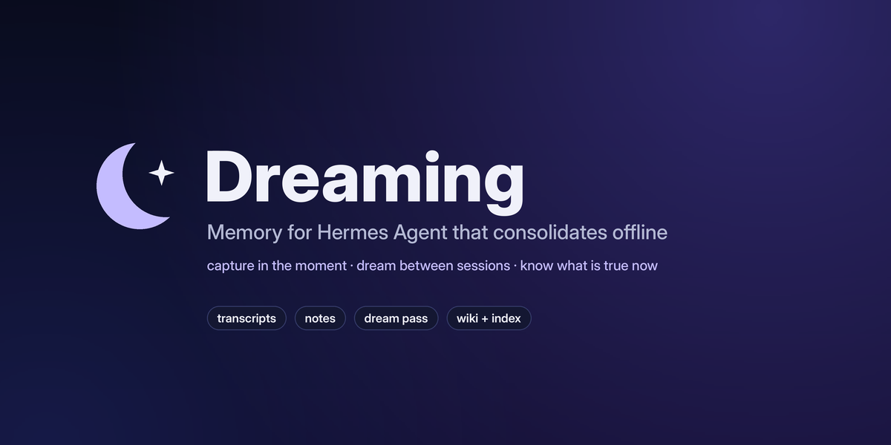
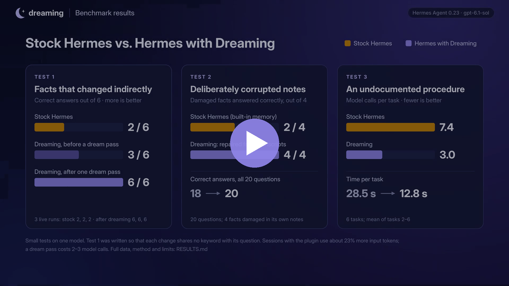

<p align="center"></p>

# Dreaming

**A memory plugin for [Hermes Agent](https://hermes-agent.nousresearch.com/) that keeps your agent
current, not just informed.**

Your agent can search every conversation it has had with you, and still get today's facts wrong.
People rarely announce changes. They say *"Sunniva's last day was yesterday, Halvard has taken over
everything of hers"*, and never mention which service just changed owner. Search finds the session
where the old fact was stated, and the agent repeats it with confidence.

Dreaming follows the architecture in Anthropic's
[The components of agent memory](https://www.anthropic.com/research/components-of-agent-memory):
**capture in the moment, consolidate offline.** While you work it records every session and lets
the agent jot quick notes. Between sessions a **dream pass** rereads those sessions in order,
checks the notes against what was actually said, works out what each change referred to, and
rewrites a linked wiki and a short index that every new session starts with.

## Demo

[](docs/dreaming-demo.mp4)

**[▶ Watch the 2-minute demo](docs/dreaming-demo.mp4)**: the problem, how it works, a live Hermes
session, and the benchmark results. The terminal footage is a real Hermes session recorded live,
with waiting time shortened.

## Results

Stock Hermes (built-in memory and session search) against Hermes with Dreaming, same model, same
data. Details, method and limits: [RESULTS.md](RESULTS.md).

| Test | Stock Hermes | Dreaming, no dream yet | Dreaming, after one dream pass |
|---|---|---|---|
| **1 · Facts that changed indirectly** (correct of 6, three runs) | 2, 2, 2 | 2, 2, 3 | **6, 6, 6** |
| **2 · Facts damaged in the agent's own notes** (correct of 4) | 2 | 4 | **4** |
| **3 · A procedure nobody wrote down** (model calls per task) | 7.4 | 6.6 | **3.0** |
| 3 · Time per task | 28.5 s | 23.4 s | **12.8 s** |

These are small tests on one model (`gpt-6.1-sol`, Hermes 0.23.1). Test 1 was written so that each
change shares no keyword with its question, which is exactly where keyword search fails. Sessions
with the plugin use about 23% more input tokens, and a dream pass costs 2–3 model calls.

## Quick start

Requires Hermes Agent 0.23.1 or newer. No API keys, no Python dependencies.

```bash
hermes plugins install hsyvy/dreaming-memory/dreaming
```

```bash
hermes config set memory.provider dreaming
```

Start a new session and chat as usual. Dreaming happens on its own in the background when a new
session starts, or run it yourself:

```bash
hermes dreaming dream
```

```bash
hermes dreaming show
```

Full reference (how it works, commands, settings, data and disclosure):
**[dreaming/README.md](dreaming/README.md)**.

## How it works

```
 while you work                     offline                          every new session
┌──────────────────────┐      ┌──────────────────────────┐      ┌──────────────────────────┐
│ transcripts/         │      │ the dream pass           │      │ index.md                 │
│   every turn, as the │ ───▶ │ 1 verify notes against   │ ───▶ │   short, current picture │
│   ground truth       │      │   what was said          │      │   loaded into the prompt │
│ notes/               │      │ 2 fold sessions into the │      │ wiki/                    │
│   quick notes by the │      │   wiki, in order         │      │   one linked page per    │
│   agent              │      │ 3 repair [[links]]       │      │   subject, recalled per  │
│                      │      │ 4 rewrite the index      │      │   message                │
└──────────────────────┘      └──────────────────────────┘      └──────────────────────────┘
```

- Everything is local markdown and JSONL in `~/.hermes/dreaming/` (or the profile's folder).
- The dream pass calls your configured model through Hermes' plugin LLM API. Nothing else leaves
  the machine.
- The model can only rewrite `index.md`, `notes/` and `wiki/`; transcripts are read-only, and memory
  is backed up before every pass.

## Repository

| Path | What it is |
|---|---|
| [`dreaming/`](dreaming/) | The plugin. This folder is what gets installed. |
| [`tests/`](tests/) | Unit tests, no model calls: `./run_tests.sh` |
| [`bench/`](bench/) | The three live benchmarks, run against a real Hermes install |
| [`RESULTS.md`](RESULTS.md) | Benchmark results, method and limits |
| [`docs/`](docs/) | Demo video and images |

## Run the tests

```bash
./run_tests.sh
```

They use Hermes' own interpreter (`~/.hermes/hermes-agent/venv`, or set `HERMES_SRC`) so the
provider is driven through Hermes' real `MemoryManager`; the dream pass runs against a scripted fake
model.

## Run the benchmarks

Each creates throwaway Hermes profiles (cloned config and logins, empty memory), uses whatever model
Hermes is configured with, and leaves your default profile alone.

```bash
python3 bench/workweek.py all
```

```bash
python3 bench/run_bench.py --corrupt inplace
```

```bash
python3 bench/run_loop.py
```

## License

[MIT](LICENSE)
